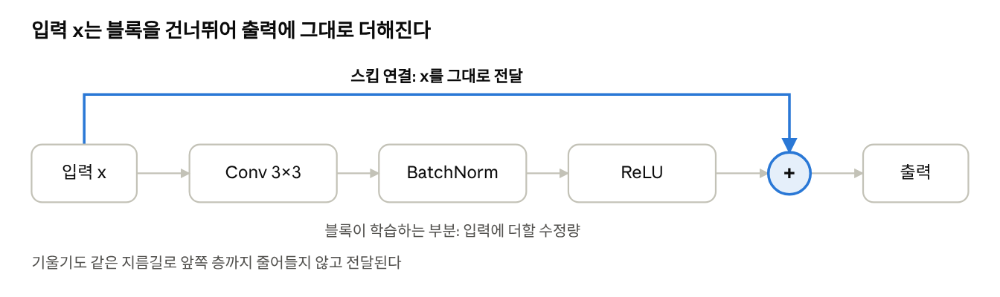
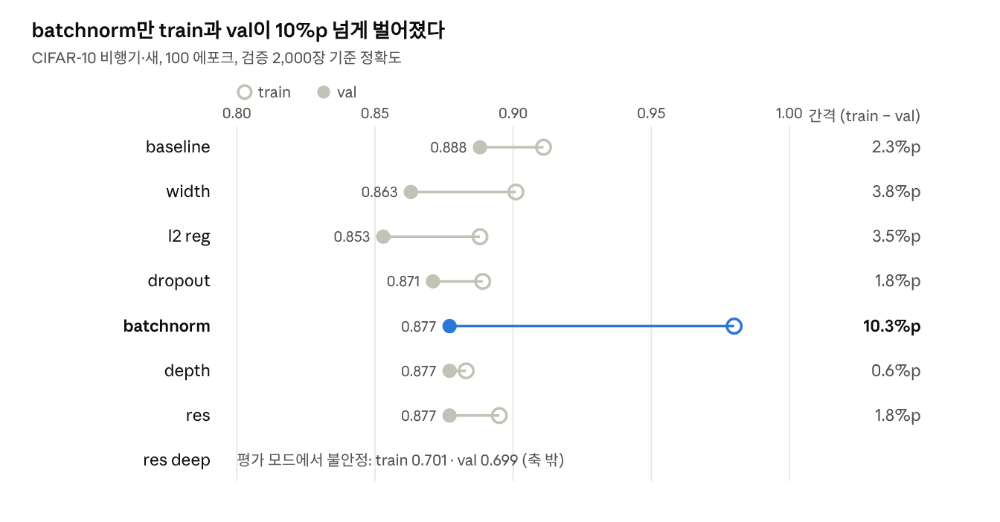

# PyTorch 8장 정리: 컨볼루션을 활용한 일반화

2026-10-04 · 교재: 『파이토치 딥러닝 마스터』(엘리 스티븐스, 루카 안티가, 토마스 피이만 지음, 현동석 옮김, 책만, 2022)

## 들어가며

8장의 결론은 하나다. 합성곱을 쓰면 파라미터를 크게 줄이면서도 처음 보는 이미지에서 더 잘 맞히는 모델을 만들 수 있다.

7장에서는 32×32 컬러 이미지를 3,072개 숫자로 펼쳐 완전연결층(`nn.Linear`)에 넣었다. 이 방식에는 두 가지 문제가 있다.

- **위치를 모른다.** 펼치는 순간 어떤 픽셀이 옆에 붙어 있었는지 정보가 사라진다.
- **파라미터가 너무 많다.** 픽셀마다 따로 가중치를 두니 모델이 커지고, 학습 데이터를 외워버리는 과적합이 쉽게 생긴다.

8장은 이 두 문제를 합성곱으로 푼다. 데이터는 7장과 같이 CIFAR-10에서 비행기(0)와 새(2)만 골라낸 `cifar2`를 쓴다. 학습용 10,000장, 검증용 2,000장이다.

## 합성곱: 작은 필터를 이미지 전체에 미끄러뜨리기

합성곱은 3×3 같은 작은 가중치 판(커널, 필터)을 이미지 위에서 한 칸씩 옮기며, 각 위치의 주변 픽셀과 가중치를 곱해 더하는 연산이다. 핵심은 두 가지다.

- **지역성**: 한 번에 주변 픽셀만 본다. 모서리나 질감처럼 가까이 붙은 픽셀이 만드는 패턴을 잡아낸다.
- **가중치 공유**: 같은 필터를 이미지 전체에 재사용한다. 그래서 새가 왼쪽에 있든 오른쪽에 있든 같은 방식으로 찾고, 파라미터 수도 이미지 크기와 상관없이 작다.

```python
conv = nn.Conv2d(3, 16, kernel_size=3)  # 입력 3채널(RGB) → 출력 16채널
conv.weight.shape, conv.bias.shape
# (torch.Size([16, 3, 3, 3]), torch.Size([16]))
```

가중치 모양 `[16, 3, 3, 3]`은 "3×3 필터가 입력 3채널마다 하나씩, 그런 묶음이 출력 채널 16개만큼"이라는 뜻이다. 파라미터는 16×3×3×3 + 16 = 448개뿐이다.

### 패딩으로 크기 유지하기

3×3 필터는 가장자리에서 한 칸씩 모자라서, 그냥 적용하면 32×32가 30×30으로 줄어든다. `padding=1`을 주면 테두리에 0을 한 줄 둘러서 크기가 그대로 유지된다. 패딩은 출력 크기만 바꾸고, 학습되는 파라미터 수에는 영향을 주지 않는다.

```python
conv = nn.Conv2d(3, 1, kernel_size=3, padding=1)
conv(img.unsqueeze(0)).shape   # torch.Size([1, 1, 32, 32])
```

`unsqueeze(0)`은 이미지 한 장 앞에 배치 차원을 붙이는 것이다. `nn.Conv2d`는 항상 `[배치, 채널, 높이, 너비]` 4차원 입력을 받는다.

### 필터를 직접 정해 보면

학습 전에 가중치를 손으로 넣어 보면 필터가 무엇을 하는지 눈으로 확인할 수 있다.

```python
with torch.no_grad():
    conv.bias.zero_()
    conv.weight.fill_(1.0 / 9.0)   # 9칸 평균 → 흐릿하게(blur)

with torch.no_grad():
    conv.weight[:] = torch.tensor([[[[-1.0, 0.0, 1.0],
                                     [-1.0, 0.0, 1.0],
                                     [-1.0, 0.0, 1.0]]]])  # 세로 가장자리 검출
```

모든 칸이 1/9이면 주변 평균이라 이미지가 뿌옇게 흐려진다. 왼쪽이 -1, 오른쪽이 +1인 필터는 좌우 밝기 차이가 큰 곳, 즉 세로 경계선에서 값이 커진다. 학습이란 이런 필터를 사람이 정하는 대신 데이터로부터 찾아내는 과정이다.

## 풀링: 크기를 줄여 더 넓게 보기

3×3 필터는 좌우 한 칸씩만 보기 때문에, 그대로는 이미지 전체를 보는 판단을 할 수 없다. 그래서 합성곱 뒤에 **다운샘플링**을 넣는다. 가장 흔한 방법이 맥스 풀링이다.

```python
pool = nn.MaxPool2d(2)
pool(img.unsqueeze(0)).shape   # [1, 3, 32, 32] → [1, 3, 16, 16]
```

`MaxPool2d(2)`는 이미지를 2×2 칸으로 나눠 각 칸에서 가장 큰 값 하나만 남긴다. 가로세로가 절반이 되고, 필터가 강하게 반응한 자리는 살아남는다. 학습할 파라미터는 없다.

합성곱과 풀링을 번갈아 쌓으면, 뒷쪽 층의 3×3 필터 한 칸이 원본 이미지의 더 넓은 영역에 해당하게 된다. 이렇게 한 출력값이 영향을 받는 원본 영역을 \*\*수용 영역(receptive field)\*\*이라고 한다. 앞쪽 층은 모서리 같은 작은 패턴을, 뒷쪽 층은 날개나 부리처럼 그것들이 모인 큰 패턴을 본다.

## 모델 만들기: 세 가지 작성법

같은 모델을 세 가지 방식으로 쓸 수 있고, 결과는 모두 파라미터 18,090개짜리 같은 모델이다.

### 1. `nn.Sequential`: 층을 순서대로 나열

```python
model = nn.Sequential(
    nn.Conv2d(3, 16, kernel_size=3, padding=1),
    nn.Tanh(),
    nn.MaxPool2d(2),
    nn.Conv2d(16, 8, kernel_size=3, padding=1),
    nn.Tanh(),
    nn.MaxPool2d(2),
    nn.Flatten(),
    nn.Linear(8 * 8 * 8, 32),
    nn.Tanh(),
    nn.Linear(32, 2)
)
```

간단하지만 데이터가 일직선으로만 흐른다. 중간 결과를 두 번 쓰거나 길을 나눠야 하는 구조(뒤의 스킵 연결)는 만들 수 없다.

### 2. `nn.Module` 상속: 층은 `__init__`, 흐름은 `forward`

학습할 층을 `__init__`에 속성으로 등록하고, 데이터가 지나가는 순서는 `forward`에 직접 쓴다. `super().__init__()`을 가장 먼저 호출해야 층들이 모델의 파라미터로 등록된다.

### 3. functional API: 파라미터 없는 연산은 함수로

`tanh`나 풀링처럼 학습할 가중치가 없는 연산은 굳이 층으로 등록할 필요가 없다. `torch.tanh`, `F.max_pool2d`로 `forward`에서 바로 부르면 코드가 짧아진다. 이 글에서 계속 쓸 기본 모델이다.

```python
import torch.nn.functional as F

class Net(nn.Module):
    def __init__(self):
        super().__init__()
        self.conv1 = nn.Conv2d(3, 16, kernel_size=3, padding=1)
        self.conv2 = nn.Conv2d(16, 8, kernel_size=3, padding=1)
        self.fc1 = nn.Linear(8 * 8 * 8, 32)
        self.fc2 = nn.Linear(32, 2)

    def forward(self, x):
        out = F.max_pool2d(torch.tanh(self.conv1(x)), 2)
        out = F.max_pool2d(torch.tanh(self.conv2(out)), 2)
        out = out.view(-1, 8 * 8 * 8)
        out = torch.tanh(self.fc1(out))
        out = self.fc2(out)
        return out
```

### 이미지 한 장이 지나가는 길

| 단계 | 출력 모양 | 파라미터 |
| --- | --- | --- |
| 입력 | 3 × 32 × 32 | – |
| conv1 + tanh | 16 × 32 × 32 | 448 |
| max\_pool2d | 16 × 16 × 16 | 0 |
| conv2 + tanh | 8 × 16 × 16 | 1,160 |
| max\_pool2d | 8 × 8 × 8 | 0 |
| view | 512 | 0 |
| fc1 + tanh | 32 | 16,416 |
| fc2 | 2 | 66 |
| **합계** |  | **18,090** |

파라미터의 90%가 `fc1`에 있다. 합성곱 층은 필터를 재사용하니 작고, 펼친 벡터를 받는 완전연결층이 크다.

### `view`: 모양만 바꾸기

합성곱을 지난 데이터는 `[배치, 8, 8, 8]` 모양인데 `nn.Linear`는 한 줄짜리 벡터를 받는다. `view(-1, 512)`는 값은 그대로 두고 `[배치, 512]`로 펼친다. `-1`은 "나머지로 알아서 계산"이라는 뜻이라 배치 크기가 바뀌어도 그대로 동작한다.

`view`의 숫자와 `fc1`의 입력 크기는 반드시 같아야 한다. 다르면 `mat1 and mat2 shapes cannot be multiplied` 오류가 난다.

```python
sum(p.numel() for p in model.parameters())   # 18090
```

## 학습과 검증: train 0.89, val 0.87

기본 `Net`을 100 에포크 학습한 결과, 처음 보는 검증 이미지에서도 87%를 맞혔다. 학습 정확도와의 차이가 2%p밖에 안 나는 것이 합성곱이 일반화에 강하다는 증거다.

### GPU로 학습하기

GPU를 쓰려면 **모델과 데이터를 둘 다** 같은 장치로 옮겨야 한다. 하나만 옮기면 장치가 다르다는 오류가 난다.

```python
device = torch.device('cuda' if torch.cuda.is_available() else 'cpu')


    for epoch in range(1, n_epochs + 1):
        loss_train = 0.0
        for imgs, labels in train_loader:
            imgs = imgs.to(device)          # 데이터도 GPU로
            labels = labels.to(device)
            outputs = model(imgs)
            loss = loss_fn(outputs, labels)

            optimizer.zero_grad()
            loss.backward()
            optimizer.step()
            loss_train += loss.item()

        if epoch == 1 or epoch % 10 == 0:
            print(f'Epoch {epoch}, Training loss {loss_train / len(train_loader)}')

train_loader = torch.utils.data.DataLoader(cifar2, batch_size=64, shuffle=True)
model = Net().to(device)                     # 모델을 GPU로
optimizer = optim.SGD(model.parameters(), lr=1e-2)
loss_fn = nn.CrossEntropyLoss()

training_loop(100, optimizer, model, loss_fn, train_loader)
```

Colab T4 GPU에서 100 에포크에 약 42초 걸렸다. 손실은 에포크 1에서 0.685, 10에서 0.444, 50에서 0.285, 100에서 0.223으로 꾸준히 줄었다.

### 검증은 반드시 처음 보는 데이터로

검증 로더를 학습 데이터(`cifar2`)로 만들면 train과 val이 항상 같게 나오고, 과적합인지 알 수 없다. CIFAR-10의 테스트 세트(`train=False`)에서 같은 두 클래스를 골라 쓴다.

```python
cifar10_val = datasets.CIFAR10(root='.', train=False, download=True, transform=transform)
cifar2_val = [(img, 0 if label == 0 else 1) for img, label in cifar10_val if label in [0, 2]]

val_loader = torch.utils.data.DataLoader(cifar2_val, batch_size=64, shuffle=False)
```

평가할 때는 `torch.no_grad()`로 기울기 계산을 끄고, 출력 점수 두 개 중 큰 쪽(`torch.max(outputs, dim=1)`)을 예측값으로 쓴다.

| 데이터 | 장 수 | 정확도 |
| --- | --- | --- |
| train | 10,000 | 0.89 |
| val | 2,000 | 0.87 |

### 모델 저장과 불러오기

모델 자체가 아니라 가중치(`state_dict`)만 저장한다. 불러올 때는 같은 구조의 빈 모델을 만들고 가중치를 채운다.

```python
data_path = '/content/'
torch.save(model.state_dict(), data_path + 'birds_vs_airplanes.pt')

loaded_model = Net().to(device)
loaded_model.load_state_dict(torch.load(data_path + 'birds_vs_airplanes.pt',
                                        map_location=device))
# <All keys matched successfully>
```

Colab의 `/content/`는 런타임이 초기화되면 사라진다. 오래 보관하려면 Google Drive를 연결해 그쪽에 저장하자. `map_location`을 주면 GPU에서 저장한 가중치를 CPU 환경에서도 불러올 수 있다.

## 모델 설계 개선하기

기본 `Net`을 출발점으로 너비, 정규화, 깊이 세 방향으로 모델을 바꿔 본다. 목표는 두 가지다. 더 복잡한 패턴을 담을 수 있게 하고(용량), 그러면서도 학습 데이터를 외우지 않게 하는 것(일반화)이다.

| 모델 | 바뀐 점 | 파라미터 | 노리는 효과 |
| --- | --- | --- | --- |
| `Net` | 기준 | 18,090 | – |
| `NetWidth` | 첫 층 채널 16 → 32 | 38,386 | 용량 늘리기 |
| `NetWidth` + L2 | 손실에 가중치 제곱합 추가 | 38,386 | 과적합 억제 |
| `NetDropout` | 합성곱 뒤 `Dropout2d(p=0.4)` | 38,386 | 과적합 억제 |
| `NetBatchNorm` | 합성곱 뒤 `BatchNorm2d` | 38,482 | 학습 안정화 |
| `NetDepth` | 합성곱 3층 + ReLU | 16,130 | 수용 영역 넓히기 |
| `NetRes` | 3층에 스킵 연결 1개 | 16,130 | 깊어도 학습되게 |
| `NetResDeep` | ResBlock 10개 | 75,810 | 아주 깊은 모델 |

파라미터 수는 노트북의 클래스 정의로 계산했다. `NetResDeep`은 블록 10개가 가중치를 공유하는 교재 방식 기준이다(아래 참고).

### 너비: 채널 수 늘리기

필터 개수(출력 채널)를 늘리면 한 층에서 더 다양한 패턴을 찾을 수 있다. 채널 수를 인자로 받으면 실험이 편하다.

```python


    def __init__(self, n_chans1=32):
        super().__init__()
        self.n_chans1 = n_chans1
        self.conv1 = nn.Conv2d(3, n_chans1, kernel_size=3, padding=1)
        self.conv2 = nn.Conv2d(n_chans1, n_chans1 // 2, kernel_size=3, padding=1)
        self.fc1 = nn.Linear(8 * 8 * n_chans1 // 2, 32)
        self.fc2 = nn.Linear(32, 2)

    def forward(self, x):
        out = F.max_pool2d(torch.tanh(self.conv1(x)), 2)
        out = F.max_pool2d(torch.tanh(self.conv2(out)), 2)
        out = out.view(-1, 8 * 8 * self.n_chans1 // 2)
        out = torch.tanh(self.fc1(out))
        return self.fc2(out)
```

채널이 16 → 32가 되면 펼친 벡터도 512 → 1,024가 되고, `fc1` 가중치가 두 배로 늘어 전체가 38,386개가 된다.

### 정규화 세 가지

**L2 정규화(가중치 감쇠)**: 손실에 모든 가중치의 제곱합을 작게 더해, 가중치가 지나치게 커지지 않도록 누른다.

```python
l2_lambda = 0.001
l2_norm = sum(p.pow(2.0).sum() for p in model.parameters())
loss = loss + l2_lambda * l2_norm
```

SGD의 `weight_decay=0.001` 인자로도 같은 효과를 낼 수 있다. 이 방식으로 학습하면 출력되는 손실에 정규화 항이 포함되어 값이 더 커 보인다.

**드롭아웃**: 학습 중 무작위로 일부 출력값을 0으로 바꿔 그 뉴런을 잠시 꺼 둔다. 남은 값은 1/(1−p)배로 키워 전체 신호 크기를 유지한다. 꺼질 뉴런은 배치마다 새로 정해지므로, 모델이 특정 뉴런 몇 개에만 기대지 못한다. `Dropout2d(p=0.4)`는 채널 단위로 40%를 끈다.

**배치 정규화**: 미니배치마다 각 채널의 평균과 분산을 맞춰, 활성 함수에 들어가는 값의 범위를 일정하게 한다. 학습이 빨라지고 학습률에 덜 민감해진다. 채널마다 학습 파라미터 2개가 있어 32 × 2 + 16 × 2 = 96개가 늘었다.

드롭아웃과 배치 정규화는 학습할 때와 평가할 때 동작이 다르다. 평가 전에는 반드시 `model.eval()`, 학습을 다시 시작할 때는 `model.train()`을 호출해야 한다.

### 깊이: 층을 쌓고 스킵 연결로 잇기

`NetDepth`는 합성곱을 3층으로 늘리고 풀링도 3번 해서 마지막 크기가 4×4가 된다. 그래서 `fc1` 입력이 256으로 줄고, 층은 늘었는데 전체 파라미터는 16,130개로 오히려 적다. 활성 함수도 `tanh` 대신 `relu`를 쓴다.

층이 깊어지면 역전파 때 기울기가 앞쪽 층까지 가면서 점점 작아져 학습이 잘 안 된다. `NetRes`는 한 층의 입력을 출력에 그대로 더해 지름길을 만든다. 이것이 **스킵 연결**이다.

```python
out = F.max_pool2d(torch.relu(self.conv2(out)), 2)
out1 = out
out = F.max_pool2d(torch.relu(self.conv3(out)) + out1, 2)   # 입력을 더함
```

### ResBlock과 NetResDeep

스킵 연결을 블록으로 묶어 여러 개 쌓으면 ResNet 구조가 된다. 블록은 입력과 출력 모양이 같아서 몇 개를 쌓아도 크기가 변하지 않는다.



블록은 입력을 새로 만드는 대신 입력에 더할 차이만 배운다. 블록이 아무것도 배우지 못해도 입력은 그대로 다음으로 넘어간다.

```python
class ResBlock(nn.Module):
    def __init__(self, n_chans):
        super().__init__()
        self.conv = nn.Conv2d(n_chans, n_chans, kernel_size=3, padding=1, bias=False)
        self.batch_norm = nn.BatchNorm2d(num_features=n_chans)
        torch.nn.init.kaiming_normal_(self.conv.weight, nonlinearity='relu')
        torch.nn.init.constant_(self.batch_norm.weight, 0.5)
        torch.nn.init.zeros_(self.batch_norm.bias)

    def forward(self, x):
        out = self.conv(x)
        out = self.batch_norm(out)
        out = torch.relu(out)
        return out + x

class NetResDeep(nn.Module):
    def __init__(self, n_chans1=32, n_blocks=10):
        super().__init__()
        self.n_chans1 = n_chans1
        self.conv1 = nn.Conv2d(3, n_chans1, kernel_size=3, padding=1)
        self.resblocks = nn.Sequential(*(n_blocks * [ResBlock(n_chans=n_chans1)]))
        self.fc1 = nn.Linear(8 * 8 * n_chans1, 32)
        self.fc2 = nn.Linear(32, 2)

    def forward(self, x):
        out = F.max_pool2d(torch.relu(self.conv1(x)), 2)
        out = self.resblocks(out)
        out = F.max_pool2d(out, 2)
        out = out.view(-1, 8 * 8 * self.n_chans1)
        out = torch.relu(self.fc1(out))
        return self.fc2(out)
```

블록이 채널 수를 바꾸지 않으니 `NetWidth`와 달리 `view`와 `fc1`에 `// 2`가 없다. 블록의 가중치는 ReLU에 맞는 Kaiming 초기화로, 배치 정규화는 0.5로 작게 시작해 초반에는 지름길 쪽이 주도하게 한다.

참고로 `n_blocks * [ResBlock(...)]`은 블록을 한 번 만들어 10번 가리킨다. 그래서 10개가 가중치를 공유한다. 블록마다 따로 학습시키려면 리스트 컴프리헨션을 쓴다. 이때 파라미터는 159,330개가 된다.

```python
이  nn.Sequential(*[ResBlock(n_chans=n_chans1) for _ in range(n_blocks)])
```

## 실습하며 만난 오류와 해결

코드를 따라 치면서 실제로 막혔던 곳들이다. 대부분 모양과 장치를 맞추지 않아서 생긴다.

| 증상 | 원인 | 해결 |
| --- | --- | --- |
| 학습이 멈춘 것 같아 중단 → `KeyboardInterrupt` | `print`가 `for epoch` 밖에 있어 100 에포크 동안 출력이 없었음 | `if epoch ...` 줄을 루프 안으로 들여쓰기 |
| GPU를 켜도 느림 | 학습 셀에서 `model = Net()`을 다시 만들어 CPU 모델이 됨 | `model = Net().to(device)` |
| 정확도 0.50 | 학습 루프가 오류로 멈춰, 학습 안 된 모델을 평가함 | 학습 루프에 `imgs.to(device)`, `labels.to(device)` 추가 후 다시 학습 |
| train과 val 정확도가 항상 같음 | `val_loader`를 학습 데이터로 만듦 | `train=False`로 만든 `cifar2_val` 사용 |
| `Input type (torch.cuda.FloatTensor) and weight type (torch.FloatTensor)` | 데이터는 GPU, 모델은 CPU | 모델에 `.to(device)` |
| `NameError: loaded_model`, `data_path` | 변수를 정의하는 줄을 실행하지 않음 | 정의와 사용을 같은 셀에서 실행 |
| `unexpected keyword argument 'pedding'` | 오타 | `padding` |
| 파라미터 71,154 (교재 38,386) | `fc1`을 `8 * 8 * n_chans1`로 써서 입력이 2,048 | `8 * 8 * n_chans1 // 2` |
| 수정했는데 결과가 그대로 | 클래스·함수 셀을 다시 실행하지 않음 | 고친 셀 먼저 실행 후 사용하는 셀 실행 |

세 가지 습관을 들이면 대부분 피할 수 있다.

1. 모델을 만들자마자 `.to(device)`, 학습·평가 루프에서는 데이터도 `.to(device)`.
2. 새 모델을 정의하면 `model(img.unsqueeze(0).to(device))`로 한 장만 통과시켜 모양을 먼저 확인.
3. 모델마다 `model_net`, `model_width`처럼 이름을 따로 붙여 덮어쓰지 않기.

## 마치며

합성곱은 작은 필터를 재사용해 적은 파라미터로 이미지의 지역 패턴을 잡고, 풀링으로 점점 넓은 영역을 본다. 이번 실습에서 파라미터 18,090개짜리 모델이 처음 보는 새와 비행기 사진을 87% 맞혔다.

여기서 더 나아가는 방법은 세 방향이다. 채널을 늘려 용량을 키우고, L2·드롭아웃·배치 정규화로 과적합을 누르고, 스킵 연결로 깊게 쌓아도 학습되게 한다. 어느 쪽이 이 데이터에 가장 효과적인지는 같은 조건으로 학습해 val 정확도를 비교해 봐야 알 수 있다. 다음 글에서 여덟 모델을 같은 조건으로 학습한 결과를 그래프로 비교해 볼 예정이다.

## 부록: 여덟 모델 비교

같은 조건(시드 0, SGD, 100 에포크)으로 학습해 보니 검증 정확도는 대부분 0.85~0.89 사이로 비슷했고, 차이는 train과의 간격에서 났다.



*노트북 실행 결과 · 8개 모델, 같은 시드·100 에포크*

배치 정규화는 학습 데이터를 가장 빨리 맞추지만 그만큼 검증과의 간격도 커졌다. 파라미터가 가장 적은 depth·res(16,130개)는 간격이 가장 작으면서 검증 정확도도 상위권이다. 100 에포크에서는 정규화가 기본 모델의 검증 정확도를 넘지는 못했다.

res deep은 학습 손실이 0.51에서 0.0036까지 떨어졌는데도, `model.eval()`로 평가하면 정확도가 0.50이었다. 배치 정규화를 학습 모드로 두면 val 0.898이 나오지만, 이는 평가 배치마다 통계를 새로 계산한 값이라 실제 성능으로 볼 수 없다. 학습이 끝난 가중치로 배치 정규화 통계를 다시 계산하자 train 0.701, val 0.699까지 회복됐다. 블록 10개를 거치며 배치 통계와 전체 통계의 작은 차이가 쌓이고, 학습 데이터에 과하게 맞춰진 모델이 그 차이에 민감해진 것으로 보인다. 교재의 `validate` 함수는 `model.eval()`을 부르지 않아 이 문제가 드러나지 않는다. 배치 정규화가 들어간 모델은 반드시 평가 모드로 재야 한다는 것이 이번 실험에서 얻은 교훈이다.
